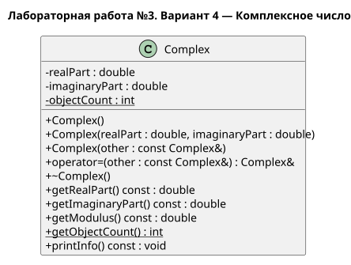

# Лабораторная работа №3

## Описание

Вариант 4 — Калькулятор комплексных чисел (`Complex`)

Лабораторная работа посвящена перегрузке операций в C++

Стандарт языка: C++14

Документация к коду создаётся с помощью Doxygen

UML-диаграмма создаётся с помощью PlantUML

## Первый этап

Реализован класс `Complex`: три конструктора, методы чтения, вывод информации, статический счетчик существующих объектов и деструктор

В `main()` проверяются начальные значения, создание и копирование чисел, неправильные аргументы конструкторов и счетчик объектов

Перегрузки операций и история калькулятора будут добавлены в следующих этапах

## Документация

- [Проектирование класса](pages/design.md)
- [Требования работы](pages/requirements.md)
- [Результат работы](pages/result.md)
- [UML-диаграмма](uml/complex.puml)



## Сборка программы

Для сборки используется файл `build.bat`. Нужен компилятор `g++` в PATH

```powershell
.\build.bat
.\build\lab3.exe
```

## Создание документации

```powershell
.\docs.bat
```

Открыть файл `docs/html/index.html`

Файл `docs.bat` запускает Doxygen и копирует диаграмму в документацию. Нужен установленный Doxygen

Исходник диаграммы можно открыть в редакторе с PlantUML или перерисовать с помощью Java:

```powershell
java -jar plantuml.jar -tsvg uml/complex.puml
```
